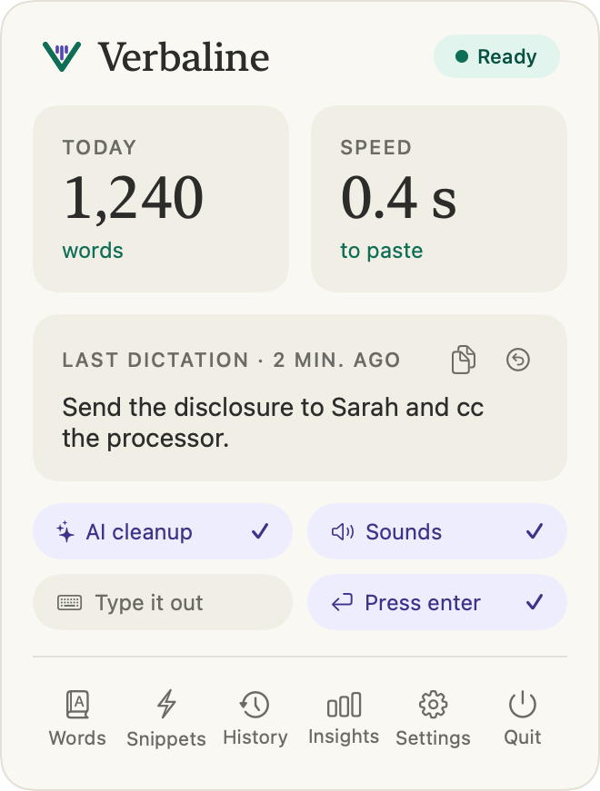
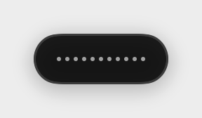
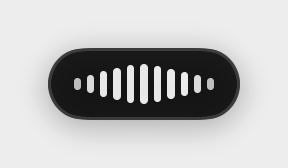
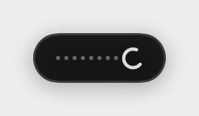
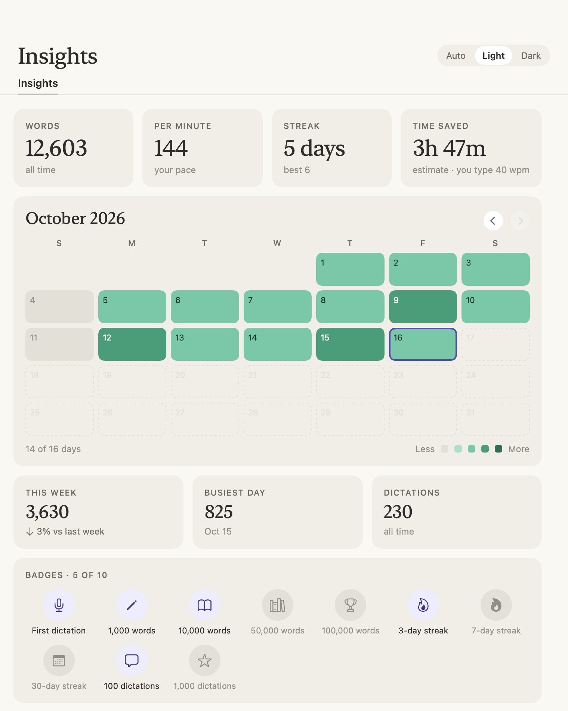

<p align="center">
  
</p>

# Verbaline

**Private, on-device voice dictation for macOS.** Hold **fn**, talk, let go, and your words appear wherever your cursor is: cleaned up, punctuated and formatted. Highlight text and hold **fn + Control** to rewrite it by voice.

Everything runs on your Mac. Speech recognition uses Whisper (large-v3-turbo, through whisper.cpp), and cleanup and rewriting use Apple's on-device model. Verbaline needs no account and has no subscription. Its only network use is a one-time download of the speech model (see [Privacy](#privacy)).

**Lives in your menu bar.** No dashboard window to keep open and no account: a small pill shows while you talk, and one click on the menu bar icon shows everything else.

<p align="center">
  
</p>

> A personal project shared as-is. It is built and tested on one Mac, so expect rough edges elsewhere. Issues and pull requests are welcome.

> **Will it work on my Mac?** You need a Mac with an Apple chip (M1 or newer) running macOS 26 or newer. To check, click the Apple menu, then **About This Mac**. There is no ready-made download: you build it yourself by pasting a few commands into Terminal (see [Install](#install)).

---

## Why Verbaline

- **Free, with no limits.** No subscription, no word cap, no account, no ads.
- **Private by design.** Your voice and your text are processed on your Mac and never sent to a server by Verbaline.
- **Open source** (MIT). You can read every line of what runs on your Mac.
- **A number guard.** When AI cleanup rewrites your dictation, the result is rejected if it changes, adds or drops a number you said (unless you corrected yourself, like "2, actually 3"). Command Mode has its own guard: a number in the output must already be in the selected text or your instruction.
- **Command Mode included.** Rewrite or draft text by voice, on-device.
- **It gets better as you use it.** Fix a misheard word once and Verbaline can remember it.

### How it compares with Wispr Flow

Verbaline was inspired by [Wispr Flow](https://wisprflow.ai), a polished commercial dictation app, and works in a similar way: hold a key, talk, and cleaned-up text appears. It is a separate project built from scratch and is not affiliated with Wispr. Details about Wispr Flow below come from its own [pricing page](https://wisprflow.ai/pricing) and [privacy policy](https://wisprflow.ai/privacy-policy), checked in October 2026; they may have changed since.

| | Verbaline | Wispr Flow |
|---|---|---|
| **Price** | Free, unlimited | Free plan up to 2,000 words a week on desktop; Pro is $12 per user per month for unlimited use |
| **Where your speech is processed** | On your Mac. Nothing you say or type is sent anywhere | Its privacy policy says it collects your audio inputs and uses service providers that include third-party AI and cloud providers |
| **Platforms** | Mac with an Apple chip, macOS 26 or newer | Mac, Windows, iPhone and Android |
| **Languages** | English | 100+ |
| **Setup** | You build it yourself (a few Terminal commands, or let an AI assistant do it) | Download from its website |
| **Teams and support** | None: a personal project shared as-is | Team plans, admin controls, customer support, SOC 2 and ISO 27001 |

If you need Windows or phones, other languages, team features or support, Wispr Flow is the better fit. If you want dictation that's free, unlimited and stays on your Mac, try Verbaline.

### Why is it free?

Because there's nothing to pay for. Verbaline has no servers: the speech engine ([Whisper](https://github.com/openai/whisper), released free by OpenAI and run through the open-source whisper.cpp) and the cleanup AI (Apple's on-device model, built into macOS) both run on your own Mac. With no servers, there are no running costs to pass on, no account to manage and no data to sell. It's shared under the MIT license, so it's free to use, change and pass on.

---

## Keys and commands

| Do this | What happens |
|---|---|
| **Hold fn**, talk, release | Push-to-talk. The text is pasted where your cursor is. |
| **Double-tap fn**, talk | Hands-free. Keeps listening until you tap **fn** once more, or choose **Stop Dictation** in the menu. It stops by itself after 20 minutes. |
| **Esc** | Cancels a recording. Also stops Type It Out. |
| Highlight text, **hold fn + Control**, say an instruction, release | **Command Mode:** rewrites the highlighted text. |
| **Hold fn + Control** with nothing highlighted | **Command Mode:** writes new text at the cursor from your instruction. |
| **Control + Command + V** | Pastes your last transcript again. |
| **Control + Command + C** | Copies your last transcript. |

### Things you can say while dictating

| Say | Result |
|---|---|
| "new line" / "new paragraph" (also "next paragraph") | a line break / a blank line |
| "bullet point" / "next bullet" | a bullet on a new line |
| "...at 2, actually make that 3" (also "no wait", "I mean", "sorry") | the correction is applied and only the final version is kept (needs AI cleanup) |
| "first ... second ... third ..." | a numbered list (needs AI cleanup) |
| A snippet trigger, like "insert my signature" | pastes your saved text exactly |
| "email **spell** K E R G E R about it" | the letters become one word |
| "**Press enter**" (said on its own) | presses Return, so a chat message gets sent. At the end of a longer dictation it is just text, so nothing is sent before you have seen it. |
| "...**make this prompt better**" (at the very end) | rewrites what you said as a clearer prompt for an AI assistant. See [Make this prompt better](#make-this-prompt-better). |

A layout command is ignored when it is clearly part of a normal sentence, such as "a new line of loans".

*AI cleanup* means Apple Intelligence is on and **AI Cleanup** is checked in the menu. Everything else works without it.

### Command Mode examples

"make this more professional", "shorten this", "turn this into bullet points", "fix the grammar", and, with nothing selected, "write a two-sentence follow-up thanking Sarah for the documents".

### Make this prompt better

Say your request, then finish with "make this prompt better". Verbaline pastes a clearer version instead: your request as one clear sentence, then an "I want:" line describing the answer you are asking for.

- **What triggers it.** Only at the very end of a dictation. Phrases that work include "make this prompt better", "make this a better prompt", "turn this into a clearer prompt", "improve this prompt", "polish this prompt" and "rewrite this prompt", optionally starting with "okay", "now" or "please" and ending with "please". In the middle of a sentence it is ordinary text.
- **What it uses.** Apple's on-device model. Nothing is sent anywhere.
- **If it fails, you lose nothing.** The rewrite is checked before it is pasted. If Apple Intelligence is off, the model takes longer than 8 seconds, the dictation is longer than 1,500 characters, or the checks fail (the AI added or dropped a number, a name or a date you did not say, answered instead of rewriting, or left out too much), Verbaline pastes your words exactly as you said them and shows the reason.
- **Undo.** After a rewrite is pasted, press **Command + Z** to undo it.
- **Switch it off.** Uncheck **"Make This Prompt Better"** in the settings menu.

---

## Features

- **Writing styles.** Formats your dictation for the kind of app it's going into. See below.
- **No text box? It's on your clipboard.** If nothing you can type into is selected, your words stay on the clipboard and Verbaline says "Copied — no text box selected. Press ⌘V to paste", so nothing you said is lost.
- **Smart cleanup.** Removes fillers like "um" and "uh", applies spoken self-corrections, and formats spoken lists.
- **Personal word list.** Fixes the spelling and capitalization of your names and terms, and gives Whisper hints about them. Names near the top of the list work best, because only about the first 540 characters are passed to Whisper.
- **Snippets.** Say a trigger phrase to paste exact saved text, such as a signature or link.
- **Spell.** Say "spell" and then the letters for names the speech engine does not know.
- **Press enter.** Said on its own, it presses Return. Verbaline never pastes and sends in one step. Switch it off in the menu.
- **Type It Out** (optional). Types your dictation letter by letter instead of pasting. Useful where pasting is blocked. Command Mode's AI-written text and rewritten prompts are always pasted. Press Esc to stop; it also stops if you switch apps.
- **History.** Recent dictations are in the menu panel; click one to copy it.
- **Learns from your edits.** Correct a misheard word after a paste and Verbaline can add the fix to your word list. Switch it off in the menu (**Learn From My Edits**).
- **Command Mode** (fn + Control). Rewrites or drafts text with Apple's on-device model.
- **Noise filter.** Looks for voiced speech in each recording, ignores recordings that have none (silence, clicks, hum), and shortens long pauses before transcribing. Switch it off in the menu.
- **Ignore Mac audio** (on by default). See below.
- **Insights.** Your words, pace, streaks and badges, from counts only. See [Insights](#insights).

### Writing styles

Verbaline adjusts punctuation to fit where you're writing. These are formatting rules only: your words and numbers are never changed, added or removed.

| Where | Default style | What it does |
|---|---|---|
| Email (Mail, Outlook, Spark and others, plus Gmail, Outlook, Yahoo and iCloud Mail in a browser) | Formal | Ends with a period and puts a greeting like "Hi Marcus," on its own line |
| Work chat (Slack, Teams, Discord, Google Chat) | Casual | Drops the final period |
| Texts (Messages, WhatsApp, Telegram, Messenger, Signal) | Casual | Drops the final period |
| Everything else | As spoken | No change |

Change any of them in the settings menu under **Writing Style** (Formal, Casual, Very casual or As spoken). To recognize email and chat sites in a browser, Verbaline reads the title of the browser window in front. That happens on your Mac and is never saved.

### Ignore Mac audio

When sound is playing out loud on your Mac's own speakers, the microphone can pick it up. With **Ignore Mac Audio** on, Verbaline works to keep that sound out of your dictation:

- It turns the speaker volume down while you talk, with a short fade, and puts it back when you finish. The music keeps playing. Choose how far in the settings menu under **Turn Speaker Sound Down To**: 50% (the default), 25%, 10% or Mute. If you change the volume yourself in the meantime, Verbaline leaves your setting alone.
- While speaker sound is playing, it uses a stricter speech filter that drops quieter sound (the speakers) and keeps your voice, which is closer to the microphone.
- Headphones and AirPods are left alone, because the microphone can't hear them.

**This is not perfect.** With music playing loudly on the MacBook's own speakers, some words can still leak into your dictation. Turn the music down, use headphones, or pick a lower speaker level for the best results.

Turn the setting off if you want the opposite, for example to transcribe a video that is playing out loud.

### The menu bar panel

- **Left-click** the Verbaline icon in the menu bar to open the panel: status, today's numbers, your last dictation, and quick switches.
- **Right-click** the icon (or Control-click) to open the full settings menu.

While you dictate, a small pill at the bottom of the screen shows what's happening:

<p align="center"></p>

| Listening | You're talking | Writing your text |
|:---:|:---:|:---:|
|  |  |  |

### Insights

Click **Insights** in the panel to see your words, pace, streaks, a calendar of the days you dictated, your busiest day and badges. "Time saved" is an estimate based on a typing speed you can set. Insights keeps only counts (words, seconds and dictations per day), never what you said, and you can reset it any time.

<picture>
  <source media="(prefers-color-scheme: dark)" srcset="docs/images/insights-dark.png">
  
</picture>

<sub>Pictures use made-up sample data.</sub>

---

## Requirements

- A Mac with Apple Silicon (M1 or newer) running macOS 26 or later
- [Homebrew](https://brew.sh)
- Xcode Command Line Tools
- About 1.6 GB of free disk space for the speech model
- English speech. Verbaline tells Whisper to expect English.
- **Apple Intelligence** turned on, for AI cleanup, Command Mode and "make this prompt better". Basic dictation works without it.

## Install

### Install with an AI assistant (easiest)

If you use an AI assistant that can run commands on your Mac, such as [Claude Code](https://claude.com/claude-code), paste the prompt below into it and it will do the setup for you. A chat-only assistant (one that can't run commands) can still walk you through the steps below one at a time.

```text
Please install Verbaline for me, a free on-device dictation app for macOS: https://github.com/JLFinance25/Verbaline

Before you start, check that this Mac has an Apple chip (M1 or newer) and macOS 26 or newer. If it doesn't, stop and tell me.
Explain each step in plain English and ask me before installing anything.

1. Make sure Apple's command line tools are installed (xcode-select --install) and that Homebrew is installed (https://brew.sh). Ask before installing either one.
2. Run: brew install whisper-cpp
3. Download the code with git clone https://github.com/JLFinance25/Verbaline.git into my home folder, then cd into it.
4. Run scripts/make-signing-identity.sh so macOS remembers Verbaline's permissions. If a keychain prompt about codesign appears, tell me to click "Always Allow".
5. Run ./build.sh --install
6. Then guide me through these, one at a time, waiting for me after each:
   - click the new Verbaline icon in the menu bar and click "Download the speech model" (1.6 GB, one time)
   - allow the Microphone when asked
   - turn on Verbaline in System Settings > Privacy & Security > Accessibility, and in Input Monitoring
   - in System Settings > Keyboard, set "Press globe key to" to "Do Nothing", if that option exists
7. Finally, have me click in a text box, hold fn, say a sentence, and let go. Confirm it worked.

If any step fails, show me the error and explain it before trying anything else. Don't change any system settings yourself.
```

### Install it yourself

1. **Open Terminal.** Press Command-Space, type `Terminal`, and press Return.
2. **Install Apple's developer tools** (skip if you already have them), then click **Install** in the window that appears:
   ```bash
   xcode-select --install
   ```
3. **Install the speech engine** with Homebrew:
   ```bash
   brew install whisper-cpp
   ```
4. **Download and build Verbaline:**
   ```bash
   git clone https://github.com/JLFinance25/Verbaline.git
   cd Verbaline
   ./build.sh --install     # builds, installs /Applications/Verbaline.app, and starts it
   ```
5. **Download the speech model.** A waveform icon appears in your menu bar. Click it, then click the **Download the speech model** prompt. This is a one-time 1.6 GB download into `~/Library/Application Support/Verbaline/models/`. Verbaline checks the file's size and SHA-256 fingerprint and only uses it if both match. You can keep working while it downloads.

The first dictation can take a little longer while the model loads.

### First-time setup

1. When macOS asks for the **Microphone**, click **Allow**.
2. Open **System Settings, Privacy & Security, Accessibility** and turn on **Verbaline**.
3. In **Privacy & Security, Input Monitoring**, turn on **Verbaline** too.
4. Open **System Settings, Keyboard** and set **"Press globe key to"** to **Do Nothing**, if your Mac has that option. Otherwise fn can open the emoji picker instead of starting dictation.
5. Click into any text box, hold **fn**, say a sentence, and let go.

| Permission | Why |
|---|---|
| Microphone | to hear you |
| Accessibility | to paste or type text, read your selection (Command Mode), and read the text box you pasted into (learning from edits) |
| Input Monitoring | to see the fn key |

Only run one dictation app at a time: two apps that both use fn will trigger each other.

### Keep permissions across rebuilds (recommended)

Apps you build yourself are "ad-hoc" signed, so macOS forgets their permissions every time you rebuild or update. To avoid that, run this once from the Verbaline folder:

```bash
scripts/make-signing-identity.sh
```

This creates a self-signed code-signing certificate named "Verbaline Local Signing" in your login keychain (or use your own name: `scripts/make-signing-identity.sh "My Name"`). It then adds a line to a file called `local.env` next to `build.sh`:

```
VERBALINE_SIGN_IDENTITY="Verbaline Local Signing"
```

`build.sh` reads that line and signs the app with the certificate. The certificate only signs apps on your own Mac, and the script does not change any trust settings. On the first build, macOS may ask whether `codesign` can use the key: choose **Always Allow**. Then rebuild with `./build.sh --install`. To undo it, delete the certificate in Keychain Access.

Optional: `local.env` can also contain `VERBALINE_BUNDLE_ID="your.id"` to change the app's bundle ID (default `local.verbaline.app`). macOS ties permissions to that ID. Use only letters, digits, dots and hyphens.

## Update

```bash
cd Verbaline
git pull
./build.sh --install
```

If you ran `brew upgrade whisper-cpp`, run `./build.sh --install` again. Verbaline uses Homebrew's copy of the speech engine, so it needs a rebuild after that upgrade.

## Uninstall

1. Click the menu bar icon, then **Quit**.
2. Drag **Verbaline** from Applications to the Trash.
3. To remove your history, word list, snippets and the speech model too, delete the folder `~/Library/Application Support/Verbaline` (in Finder: Go, then Go to Folder).
4. Optional: if you no longer need it, run `brew uninstall whisper-cpp`.

## Troubleshooting

| What you see | What to do |
|---|---|
| Holding fn opens the emoji picker | Set **System Settings, Keyboard, "Press globe key to"** to **Do Nothing**. |
| The panel says "Download the speech model" | Click it. The model is a one-time 1.6 GB download. |
| The download fails, or says it was incomplete or "didn't match the real model" | Verbaline throws away files that fail its size and SHA-256 check. Check your connection and click the prompt to try again. |
| Nothing happens when you hold fn | Open the menu bar icon (right-click for the full menu). If it shows a warning like "Needs Input Monitoring permission" or "Needs Accessibility permission", turn Verbaline on under **System Settings, Privacy & Security**. If it is already on, switch it off and on again. |
| The status says "Speech model error" | Make sure `brew install whisper-cpp` finished, then rebuild with `./build.sh --install`. If the model download was interrupted, delete `~/Library/Application Support/Verbaline/models/` and download it again from the panel. |
| It stopped working after `brew upgrade` | Rebuild: `./build.sh --install`. |
| The menu says AI Cleanup is unavailable | Turn on Apple Intelligence in **System Settings, Apple Intelligence & Siri**. Basic dictation still works without it. |
| Words from music or a video show up in your dictation | See [Ignore Mac audio](#ignore-mac-audio): lower the speaker level, use headphones, or turn the music down. |
| "Make this prompt better" pasted your words unchanged | The pill tells you why (for example "Apple Intelligence is off" or "The AI took too long"). Try a shorter request. |
| macOS asks for permissions again after every update | Do the one-time [signing step](#keep-permissions-across-rebuilds-recommended). |
| `./build.sh` fails with a compiler or SDK error | Install or update the Command Line Tools with `xcode-select --install`, or check **System Settings, General, Software Update**. |

Still stuck? [Open an issue](https://github.com/JLFinance25/Verbaline/issues) with your macOS version, what you did, and what happened.

---

## Privacy

- **Audio is not saved.** Your voice is held in memory while you speak and then discarded. Verbaline's normal code never writes audio to disk. The only code that writes audio files is in test-only builds, which are not part of a normal `./build.sh`.
- **One network use: the speech model download.** The first time you launch Verbaline, the menu bar panel offers a one-time download (1.6 GB) of the Whisper model from Hugging Face (`huggingface.co/ggerganov/whisper.cpp`). It only starts when you click, and it is a plain file download: Verbaline sends nothing about you. This is the only time Verbaline uses the network. Once the model is saved, Whisper and Apple's model both run on your Mac, and Verbaline does not send your audio or text anywhere.
- **What is stored** in `~/Library/Application Support/Verbaline/` for dictation: the speech model (`models/`), your history (`history.jsonl`, plain text; clear it any time from the menu), your word list (`dictionary.txt`), your snippets (`snippets.txt`), `stats.json` (counts of words, seconds and dictations per day, never dictation text), `status.json` (permission and engine status flags, no transcript text), and `panel-placement.txt` (a small log of where the panel opened on your screens).
- **Password fields.** You can dictate into a password field, but Verbaline does not save that dictation to your history, and does not watch the field for edits. Still, avoid dictating passwords.
- **Learn From My Edits** watches the text box you pasted into for about a minute after a paste. It reads only that box through Accessibility, skips password fields, and keeps only the pasted region.

## Use it responsibly

- **AI output can be wrong.** Proofread anything important, especially Command Mode drafts and rewritten prompts.
- **The number guard has limits.** It checks numbers written in digits, not facts or numbers spelled out in words.
- **Not for unsupervised high-stakes use.** That includes financial, legal and medical advice.
- **Not designed for regulated records.** History is saved as plain text on your Mac. Check your employer's rules before dictating client or customer information.
- **No warranty.** Verbaline is provided as-is; see [LICENSE](LICENSE).

---

## Tests

```bash
tests/run_all.sh mylabel           # builds a test version and runs every test
tests/run_all.sh mylabel --quick   # skips tests that open windows, type, or use the mic
```

The full run needs the screen unlocked, and some tests briefly open a small window and send keystrokes to it. Results are saved in `build/regress/<label>/`, so you can compare two runs with `diff -r`.

## Known limitations

- Macs with Apple Silicon on macOS 26 or later only.
- English only.
- With music playing loudly on the MacBook's own speakers, some words can still leak into dictation (see [Ignore Mac audio](#ignore-mac-audio)).
- Learning from edits only works in apps that share their text boxes through Accessibility.

## Credits

- Speech recognition: [whisper.cpp](https://huggingface.co/ggerganov/whisper.cpp) running OpenAI's Whisper large-v3-turbo model.
- Apple, Mac, macOS and Apple Intelligence are trademarks of Apple Inc. Verbaline is an independent project, not affiliated with or endorsed by Apple or OpenAI.

## License

[MIT](LICENSE)
